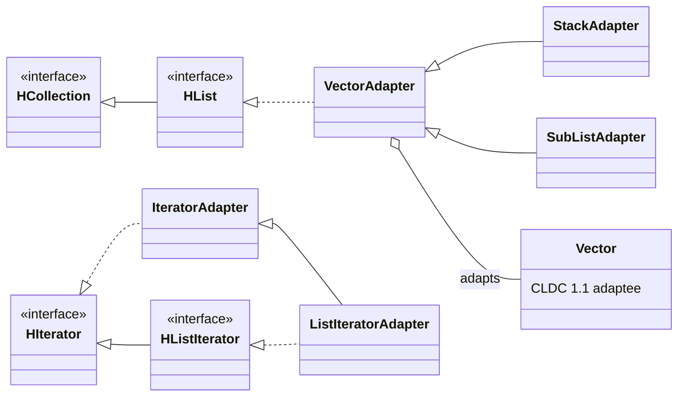

<h1 align="center">SEAdapter</h1>

<p align="center">
  An implementation of the <b>Adapter</b> design pattern that brings the J2SE 1.4.2 <code>Stack</code>
  and Collections API to <b>Java ME CLDC 1.1</b>, using only the CLDC <code>Vector</code> as the adaptee.
</p>

<p align="center">
  
  
  
  
  
</p>

---

## Overview

Java ME **CLDC 1.1** is a reduced Java platform for small devices. It has `Vector`, `Stack`,
`Enumeration` and `Hashtable`, but **none of the Java Collections Framework**: no `Collection`,
`List`, `Iterator` or `ListIterator`.

This project solves a concrete problem: running a library written for **J2SE 1.4.2**, which
uses `Stack` and the collection interfaces, on a CLDC 1.1 device. The solution is a set of
**adapters** that rebuild the 1.4.2 API on top of the CLDC `Vector`.

Key constraints:

- Only features available in **CLDC 1.1** are used inside the adapter: no generics,
  no autoboxing, no enhanced `for`, nothing introduced after Java 1.4.2.
- Behaviour matches the **J2SE 1.4.2 documentation exactly**, including **all optional
  operations** of the collections and of the iterators.
- To avoid clashes with the modern JDK interfaces, they are redefined locally as
  `HCollection`, `HList`, `HIterator` and `HListIterator`.
- Developed with **Test-Driven Development**, with 744 JUnit tests.
- Builds and runs entirely **from the command line**, with no IDE dependencies.

## Design



| Class | Role |
|---|---|
| `HCollection`, `HList` | The `Collection` and `List` interfaces of J2SE 1.4.2, with every method. |
| `HIterator`, `HListIterator` | The `Iterator` and `ListIterator` interfaces of J2SE 1.4.2. |
| `VectorAdapter` | Implements `HList` by wrapping a CLDC `Vector`. Iterators are **fail-fast**. |
| `StackAdapter` | The required adapter: a LIFO stack with `push`, `pop`, `peek`, `empty` and `search`, plus the full `HList` API. |
| `SubListAdapter` | A live view of a range of a `VectorAdapter` (returned by `subList`), supporting every list operation, including nested sublists. |
| `IteratorAdapter`, `ListIteratorAdapter` | Iterators with all optional operations (`remove`, `set`, `add`). |
| `EnumerationAdapter` | An `Enumeration` over the whole vector or a range of it. |
| `myException.IllegalStateException` | Thrown by iterators when an operation is called at the wrong time. |

## Testing

The project was built test-first. The `myTest` package contains one test class per adapter,
and `TestRunner` runs them all from the command line, reporting the total number of tests,
the failures and the execution time.

| Test class | Tests |
|---|---:|
| `SubListAdapterTest` | 276 |
| `VectorAdapterTest` | 252 |
| `ListIteratorAdapterTest` | 130 |
| `IteratorAdapterTest` | 34 |
| `StackAdapterTest` | 32 |
| `EnumerationAdapterTest` | 20 |
| **Total** | **744** |

Every test case and test method is documented in Javadoc following a fixed template:
**Summary**, **Test Case Design**, **Test Description**, **Pre-Condition**,
**Post-Condition** and **Expected Results**.

---

## Getting started

### Requirements

- A JDK (any recent version; the code itself only uses CLDC 1.1 features)
- Bash

JUnit 4.13 and Hamcrest 1.3 are included in the `JUnit/` folder, so no download is needed.

### Build, test and generate the docs

The scripts use relative paths, so run them from inside the `scripts/` folder:

```bash
git clone https://github.com/sclosaf/SEAdapter.git
cd SEAdapter/scripts

./compile.sh   # compiles the adapters into build/
./test.sh      # compiles everything and runs all the tests with TestRunner
./docs.sh      # regenerates the Javadoc in doc/
```

Expected output of `./test.sh`:

```text
SUCCESS: All 744 tests passed!
```

### Documentation

The full Javadoc (adapters and tests) is in `doc/`. Open `doc/index.html` in a browser.

---

## Repository structure

```
SEAdapter/
├── src/
│   ├── myAdapter/       # HCollection, HList, HIterator, HListIterator and the adapters
│   ├── myException/     # IllegalStateException
│   └── myTest/          # JUnit test classes and TestRunner
├── JUnit/               # junit-4.13.jar, hamcrest-core-1.3.jar
├── doc/                 # generated Javadoc
├── scripts/             # compile.sh, test.sh, docs.sh
└── Appello3.pdf         # assignment specification
```

## References

- [J2SE 1.4.2 API documentation](https://javaalmanac.io/jdk/1.4/api/index.html)
- [CLDC 1.1 API documentation](https://docs.oracle.com/javame/config/cldc/ref-impl/cldc1.1/jsr139/index.html)
